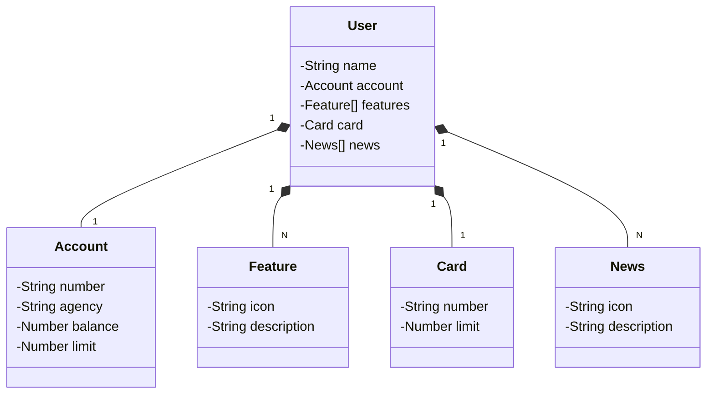

# Aviso

Deixando claro: o conteúdo abaixo parte de um curso gratuito e não pode ser redistribuído. Se quiser estudar o assunto, procure o curso aberto da trilha de Java com Spring Boot. Caso a plataforma encerre o acesso ou passe a cobrar, isso não está no meu alcance — mas o material de lá é ótimo e quem assina um plano aproveita muito mais.

# API REST do evento Santander Dev Week 2023 em Java

Serviço REST escrito em Java 17 com Spring Boot 3.

## Principais tecnologias

 - **Java 17**: a versão de suporte de longo prazo mais recente, aproveitando as novidades da linguagem.
 - **Spring Boot 3**: a versão mais nova do framework, que ganha produtividade pela proposta de autoconfiguração.
 - **Spring Data JPA**: camada de acesso a dados simplificada, com integração facilitada a bancos relacionais.
 - **OpenAPI (Swagger)**: documentação de API clara e navegável, alinhada à produtividade do framework.
 - **Railway**: hospedagem e monitoramento na nuvem, com bancos gerenciados e pipelines de integração e entrega contínuas.

## Protótipo no Figma

O protótipo serviu para abstrair o domínio da API, apoiando a análise e o projeto da solução. O link do arquivo está publicado.

## Diagrama de classes do domínio

## Documentação interativa

O endereço da documentação fica publicado na hospedagem. A API fica no ar por tempo limitado, mas o código é aberto: clone, altere e rode localmente ou onde preferir. Só não esqueça de mencionar o projeto original ao divulgar a sua versão.

### Importante

Para quem quiser desenvolver a tela inicial do aplicativo a partir do protótipo, em qualquer framework móvel: se o endereço de produção sair do ar, existe uma cópia estática dos exemplos de resposta publicada nas páginas do repositório, basta fazer uma requisição de leitura nela.

- Endereço de produção: o endereço da consulta por identificador de usuário.
- Cópia estática: o arquivo de exemplo com um usuário, publicado nas páginas do projeto.